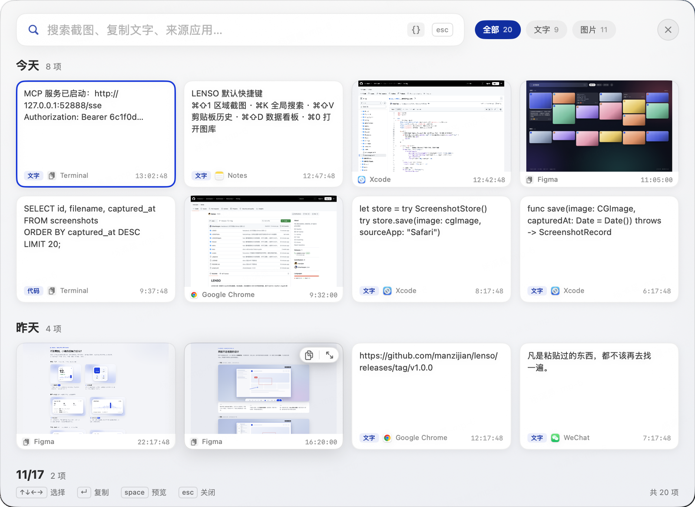
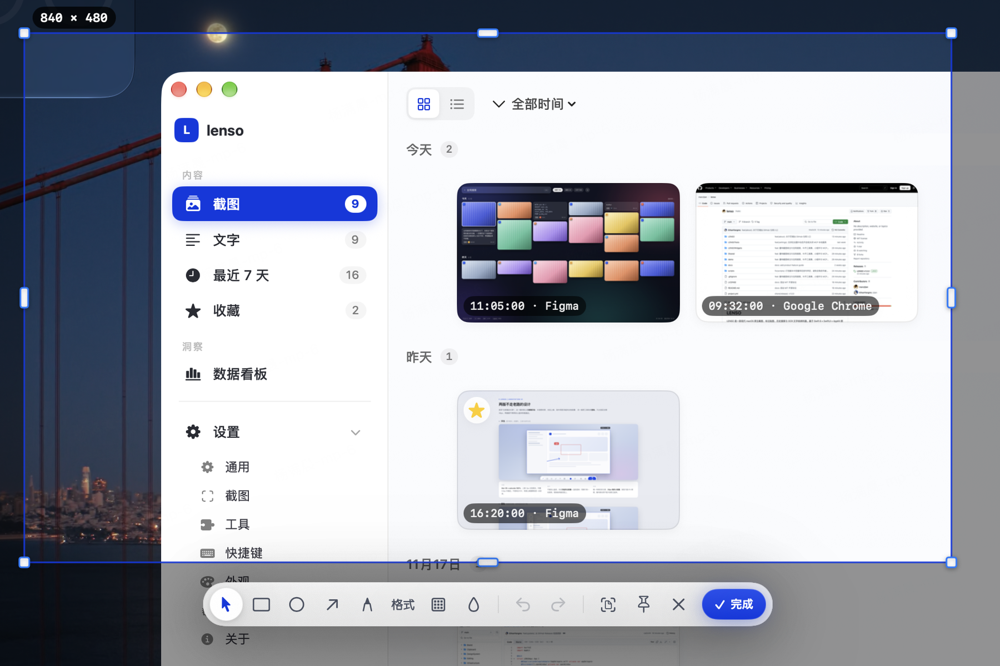
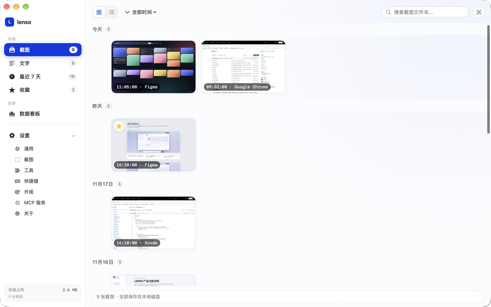
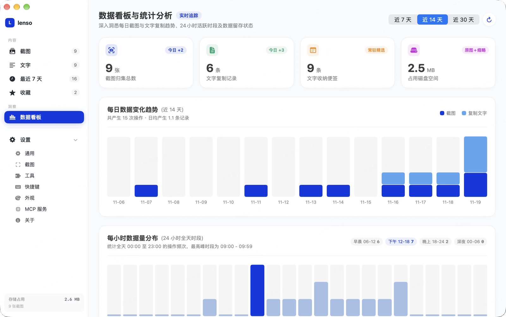
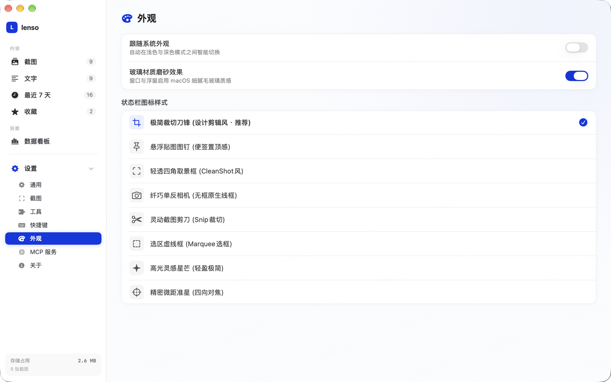

<p align="center">
  
</p>

<h1 align="center">LENSO</h1>

<p align="center">
  截图、标注、归档、搜索、剪贴板，一个菜单栏 App 全部收好。<br>
  macOS 原生 · Swift 6 + SwiftUI · 本地优先 · 内置 MCP
</p>

<p align="center">
  <a href="https://github.com/manzijian/lenso/releases/latest"></a>
  
  
  <a href="LICENSE"></a>
</p>

<p align="center">
  
</p>

LENSO 把「截图」从一次性动作，变成可以反复查找、复用的资料：截完直接标注贴图，自动按天归档进本地图库；复制过的文字、收藏的片段、截过的图，用一个搜索框全部召回；再通过内置的 MCP 服务，让 Claude Desktop、Claude Code、Cursor 等 AI 客户端直接读取你的本地素材。

所有数据只保存在本机。

---

## 核心功能

### 区域截图与标注

<p align="center"></p>

按一下快捷键唤起覆盖层，自动吸附窗口与元素边缘，方向键像素级微调。选区确定后直接进入画板：矩形、箭头、画笔、文字、高亮、马赛克、序号标记一应俱全，可撤销重做、复制到剪贴板或保存。

### 图库按天归档

<p align="center"></p>

截图自动落入本地 SQLite 图库，按「今天 / 昨天 / 具体日期」分组，来源应用与时间一目了然。支持收藏、预览、导出，缩略图独立降采样生成，几千张也不卡。

### 全局搜索：一框搜全部

<p align="center"></p>

同时检索截图、剪贴板文字与收纳便签，结果按相关度与时间混合排序。截图以照片墙形式呈现，文字支持富文本网址解析与代码高亮，按 `↑` `↓` 选择、`↩` 直接复制或跳转。

### 剪贴板历史与文字收纳

后台持续记录复制过的文字、链接与图片，按来源应用归类；查找到的内容可以一键保存为便签，长期沉淀。全部写入本地，不上传云端。

### 数据看板

<p align="center"></p>

统计最近 7 / 14 / 30 天的截图与文字记录趋势、24 小时活跃时段、磁盘占用与最常使用的来源应用，帮助你了解自己的素材积累与存储状态。

### 外观与快捷键都可自定义

<p align="center"></p>

八种菜单栏图标样式、玻璃拟态开关、跟随系统深浅色；所有全局快捷键都可在设置中重新录制，冲突时即时提示。

---

## 让 AI 读取你的素材（MCP）

LENSO 内置标准 Model Context Protocol 服务（JSON-RPC over stdio），为 AI 客户端提供以下工具：

| 工具 | 作用 |
| :--- | :--- |
| `lenso_get_recent_clipboard` | 读取最近复制的文字 / 图片及来源应用 |
| `lenso_search_history` | 全局搜索截图、剪贴板与便签 |
| `lenso_get_latest_screenshot` | 获取最新截图元数据与本地文件路径 |
| `lenso_list_screenshots` | 按天数、收藏、来源应用列出截图 |
| `lenso_get_text_notes` | 读取文字收纳便签 |
| `lenso_copy_text` | 写入系统剪贴板并记录历史 |
| `lenso_add_text_note` | 新增一条文字便签 |
| `lenso_set_screenshot_favorite` | 收藏 / 取消收藏截图 |

以 Claude Code 为例：

```bash
claude mcp add lenso -- "/Applications/lenso.app/Contents/MacOS/lenso" --mcp
```

Claude Desktop、Cursor、Windsurf 等客户端可在设置页「MCP 服务」中一键复制对应的 JSON 配置。服务仅监听本地 stdio / 环回地址，默认启用 128 位 Token 鉴权。

---

## 安装

1. 前往 [Releases](https://github.com/manzijian/lenso/releases/latest) 下载最新的 `LENSO-*.dmg`（或 `.zip`）。
2. 打开 DMG，把 `lenso.app` 拖入 `Applications`。
3. 首次启动按提示授予「屏幕录制」与「辅助功能」权限，随后即可用快捷键截图。

> 应用使用开发者自签证书签名。若首次打开被 Gatekeeper 拦截，请在「系统设置 → 隐私与安全性」中点击「仍要打开」。

## 常用快捷键

| 功能 | 默认快捷键 | 说明 |
| :--- | :--- | :--- |
| **区域截图** | `⇧ ⌘ 1` | 覆盖层选区、窗口吸附、标注画板 |
| **打开图库** | `⌘ 0` | 按天归档的本地截图库 |
| **全局搜索** | `⌘ K` | 截图 / 剪贴板 / 便签统一检索 |
| **剪贴板历史** | `⇧ ⌘ V` | 文字与图片复制记录 |
| **预览最新截图** | `⇧ ⌘ P` | 置顶预览与导出 |
| **数据看板** | `⇧ ⌘ D` | 活动趋势与存储统计 |
| **设置** | `⌘ ,` | 快捷键、存储期限、MCP 接入 |

以上快捷键均可在「设置 → 快捷键」中修改。

---

## 从源码构建

```bash
# 1. 克隆代码仓库
git clone https://github.com/manzijian/lenso.git
cd lenso

# 2. 生成 Xcode 工程（基于 project.yml）
xcodegen generate

# 3. 编译应用并自动完成固定身份代码签名
bash scripts/build.sh

# 4. 运行全量单元测试
xcodebuild test -project LENSO.xcodeproj -scheme LENSO -destination 'platform=macOS'
```

> 依赖工具：Xcode 16+ 与 [XcodeGen](https://github.com/yonaskolb/XcodeGen)（`brew install xcodegen`）。
> `scripts/build.sh` 会自动配置自签证书并进行确定性签名，避免 macOS 屏幕录制权限因 cdhash 变化而反复失效。

---

## 工程架构

- **开发语言与规范**：Swift 6 Strict Concurrency + SwiftUI / AppKit 响应式状态管理。
- **解耦设计**：
  - `ScreenCapturing`：抽象屏幕捕获服务，屏蔽 ScreenCaptureKit 权限依赖，支持测试环境 Mock 注入。
  - `ClipboardWriting`：剪贴板读写抽象，支持内存 Mock，避免污染系统剪贴板。
  - `ErrorPresenting`：统一弹窗与权限引导错误呈现。
- **存储与健壮性**：
  - SQLite 开启 WAL 模式与 `PRAGMA integrity_check` 启动自检；数据库严重损坏时自动备份并原地重建。
  - 缩略图基于 ImageIO 降采样（`kCGImageSourceThumbnailMaxPixelSize`），抑制高分辨率截图的内存峰值。
  - 数据文件与数据库路径完全可注入，单元测试在独立临时目录运行，不触碰真实数据。
- **安全与本地服务**：MCP 与本地服务仅绑定 `127.0.0.1`，默认 128 位 Token 鉴权，阻断未授权的跨域请求。
- **隐私合规**：已配置苹果官方 `PrivacyInfo.xcprivacy` 隐私清单。

## 开源协议

本项目基于 [MIT License](LICENSE) 开源，版权归 manzijian 所有。
